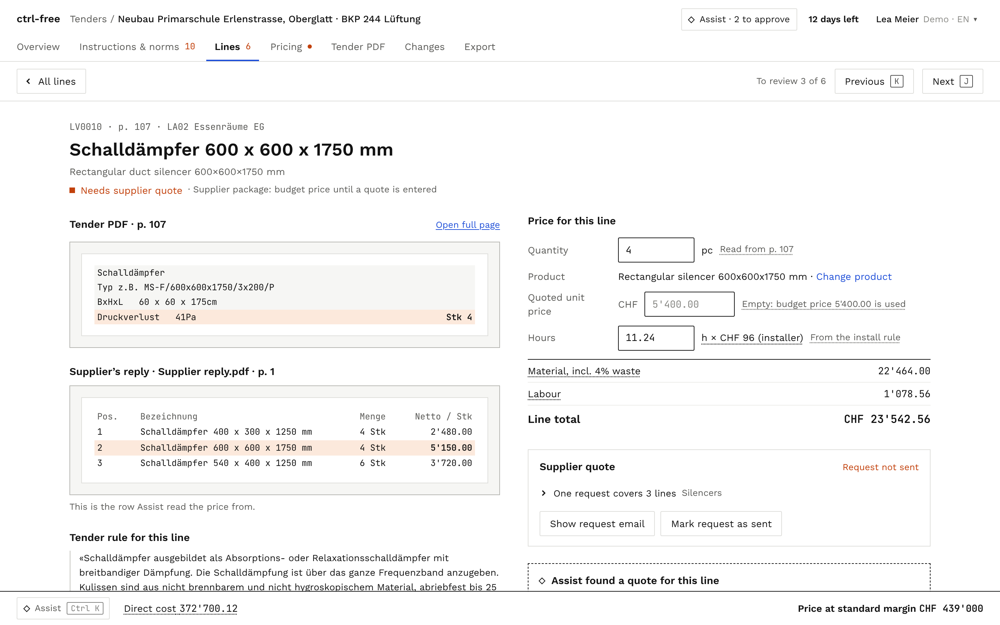
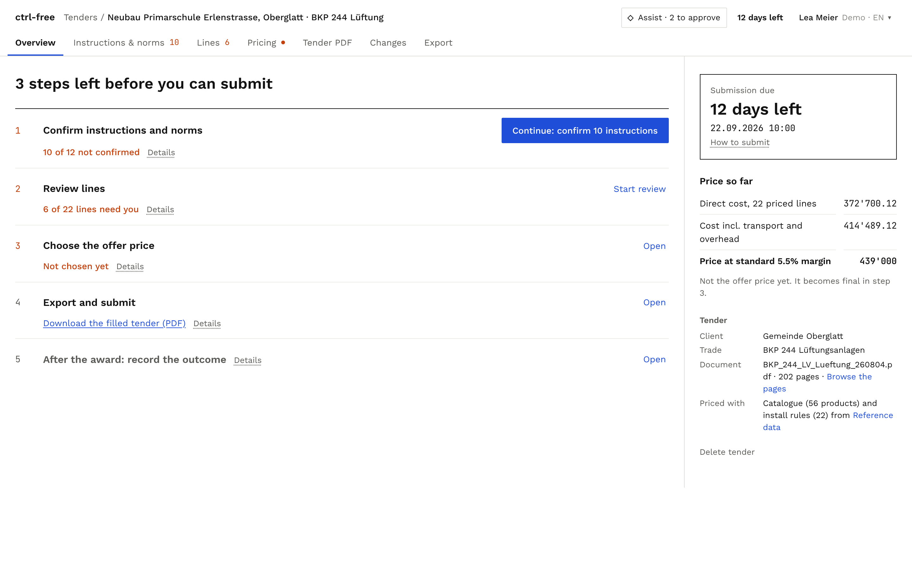
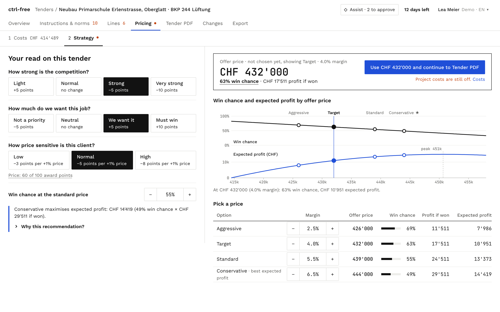

<p align="center">
  <picture>
    <source media="(prefers-color-scheme: dark)" srcset="docs/brand/sprintd-on-dark.svg" />
    
  </picture>
  &nbsp;&nbsp;&nbsp;&nbsp;
  <picture>
    <source media="(prefers-color-scheme: dark)" srcset="frontend/public/brand/equans-logo-on-dark.png" />
    
  </picture>
</p>

<h1 align="center">ctrl-free</h1>

<p align="center">From a 200-page tender to a first price, every number traced to its source.</p>

<p align="center"><b>3rd place</b> on the Equans Switzerland case <i>From tender to first price</i> at sprintd Zurich 2026 (9–11 Oct).</p>

An Equans estimator gets a 202-page ventilation tender in Swiss German and prices it by hand:
Ctrl+F through the PDF, copy positions into Excel, look up products and install hours in
handbooks. We had a weekend to cut that down.

ctrl-free reads the tender, finds every priced position, matches each one to Equans' catalogue
and install rules, and computes a first price. The estimator only looks at what needs them, gets
missing prices from suppliers, picks the offer price and exports the filled tender. The rule we
built it around: **the LLM picks, code computes, the estimator decides.**

<p align="center">
  
</p>
<p align="center">
  
  
</p>

**Demo video:** [youtu.be/sg1u-QXRCGk](https://youtu.be/sg1u-QXRCGk)

## What it does

- **Reads the tender.** Systems, sections and positions come from the PDF's own layout, with the
  page and position of every line. All 202 pages take about 4 seconds.
- **Matches products.** Code scores a shortlist of 5 catalogue products per line (type, size,
  unit); the LLM picks one or "none" and can't invent an ID. Without an LLM, the rules pick. A
  make named "z.B." in the tender counts as an example, so equivalent products are allowed.
- **Computes the price.** Material, hours with site factors, labour, direct cost. It reproduces
  all of Equans' reference numbers: 22/22 lines, the CHF 414'489.12 baseline and the 3 bid
  scenarios.
- **Shows where every number comes from.** Quantity, unit price, hours, rate and waste each open
  their source: the tender line, the catalogue or price-list row, or the install rule.
- **Learns from corrections.** When the estimator fixes a match, it becomes a rule for similar
  lines and for the next tender.
- **Handles supplier quotes.** Lines without a catalogue price are grouped into drafted request
  emails. Drop the suppliers' PDF replies in and it proposes the prices; nothing changes until
  the estimator says OK.
- **Helps pick the offer price.** Costs and overhead with their CHF effect, then a win-chance and
  expected-profit chart over four price options.
- **Keeps a history.** Every change is stamped with who made it (AI, junior, senior) and its CHF
  effect. The senior approves or reverts.
- **Exports the offer.** The original tender PDF with prices filled in on the dotted lines, an
  Excel workbook with live formulas, a pricing report and a SIA file.

## Run it locally

```bash
cp .env.example .env        # OPENAI_API_KEY or the Azure OpenAI vars; optional, it runs rules-only without
./dev.sh                    # backend on :8000, frontend on :5173
```

You need `uv` (Python 3.12) and `pnpm` (Node 20+). Open http://localhost:5173, click **New
tender**, then upload the PDF or press **Use the Oberglatt demo tender**.

No backend? The frontend falls back to built-in demo data (force it with `VITE_USE_MOCK=1`).
`frontend/.env.development` pins "today" to 10 Sep 2026 so the demo deadline reads "12 days
left"; delete it to use the real date.

There are two looks: ctrl-free (default) and the Equans brand style. Switch under the person menu
→ Style, or add `?theme=equans` to any URL.

## Under the hood

- `backend/`: FastAPI. Parser, matcher, pricing (`app/pricing.py`), exports and Assist. Tests:
  `cd backend && uv run pytest -q`.
- `frontend/`: React, Vite and Tailwind.
- `GET /api/tenders/{id}/verification` checks the output against Equans' 22 verified examples.
- [docs/DEMO.md](docs/DEMO.md): the 5-minute demo script.
- [docs/SPEC.md](docs/SPEC.md): data model and API. [docs/PRODUCTION.md](docs/PRODUCTION.md):
  what it would take to run this for real.
- `problem_statement/`: the case, the data package and the tender. `research/`: case notes, the
  original pricing engine and design canvases.
